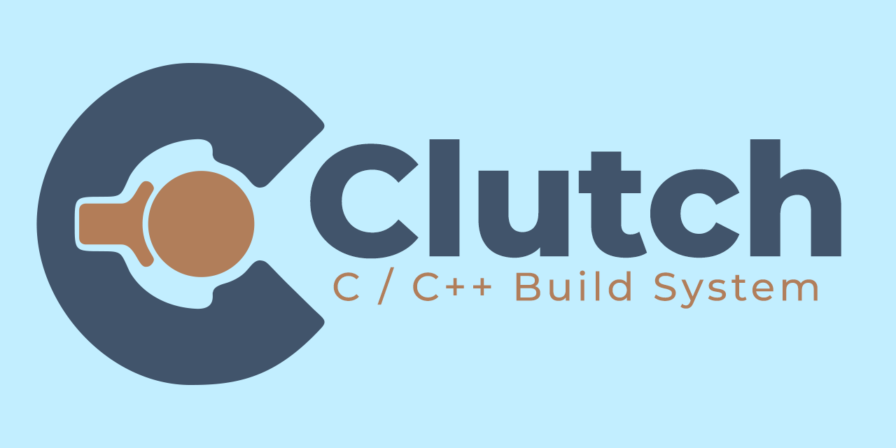

# Clutch

<p align="center">
  
</p>

A small native build system for C and C++ with a simple `clutch.toml` manifest.
Configure your project, then build, run and test it from the command line.
Clutch generates native build files and an IDE compilation database.

**Status: early development.** Clutch builds executable, static-library,
shared-library and test targets with local dependencies. Git dependencies, external-library build-system
adapters and self-hosting are planned; full CMake feature coverage is future work.

This README describes the checked-out source; published releases may have fewer
features. Check the [changelog](docs/CHANGELOG.md) for release-specific changes.

## What you can do

- Build C, C++ and mixed-language projects with explicit language standards.
- Declare multiple targets, link local libraries and propagate public headers
  and definitions. Select individual builds with `--target <name>`.
- Organize projects with `[workspace].members`, scoped member manifests and
  qualified cross-project target links. Share workspace include directories and
  definitions while allowing member overrides.
- Generate a portable `clutch.lock` and verify local resolution with `--locked`.
- Use Ninja, GNU Make, NMake, JOM, Visual Studio/MSBuild or Xcode, depending on
  your operating system and installed tools.
- Keep debug and release builds separate, with simple optimization and warning
  settings in each profile.
- Generate `compile_commands.json` in the build directory for IDEs and language
  servers, alongside a Graphviz build graph.
- Serve versioned file-API queries for project, target and toolchain metadata.
- Create projects, build incrementally, run programs and filter executable tests.

## Install from source

From a checkout, you need CMake 3.20+ and a C++17 compiler. Clutch's parser
libraries are vendored, so this build requires no dependency downloads.

```sh
cmake -S . -B build -DCMAKE_BUILD_TYPE=Release
cmake --build build --config Release
```

The executable is usually `build/clutch` on Linux/macOS, `build/clutch.exe` with
Windows single-configuration generators, or `build/Release/clutch.exe` with
Visual Studio. Add its directory to `PATH` to use the commands below.

You also need a C/C++ compiler and the build tool selected for your projects;
Ninja is the default. See the [installation guide](docs/installation.md) for
platform setup, installation prefixes and Windows compiler environments.

## Quick start

With Clutch and Ninja available on `PATH`:

```sh
clutch new hello
cd hello
clutch .
clutch build
clutch run
```

`clutch .` reads `clutch.toml` and writes configuration into
`Clutch-build-debug/` without compiling. `clutch build` compiles and links the
application. To use the release profile:

```sh
clutch . --release
clutch build --release
clutch run --release
```

Configure again after changing the manifest or adding/removing source files.
Existing source and header edits only need another build.

## A simple manifest

A C++ project with `src/main.cpp` can use:

```toml
[project]
name = "hello"
version = "0.1.0"
language = "cpp"
std = 17

[build]
generator = "ninja"
sources = ["src/main.cpp"]

[profile.debug]
build_dir = "Clutch-build-debug"

[profile.release]
build_dir = "Clutch-build-release"
optimize = "speed"
warnings = "extra"
```

Add files to `sources` for a multi-file executable, or omit it to discover
sources under `src/`. Select compilers during configuration, for example
`clutch . --cc clang --cxx clang++`. Run `clutch generators` to see available
generators and `clutch --help` for commands.

For local libraries and multiple executables, use explicit `[[target]]` entries.
Keep `project.entry` or `build.sources` for the default application and use
`build.links` to link it to those libraries; the two styles can coexist.
See the [library example](examples/targets/README.md) and
[flexible workspace example](examples/flexible/README.md), or the
[target reference](docs/manifest.md#target). The optional file-API sample uses
Python; Clutch itself serves IDE metadata directly in native C++.

## Workspaces and lock files

Split a larger repository into projects with their own `clutch.toml` files:

```toml
# Root clutch.toml
[workspace]
members = ["libraries/greeting", "applications/hello"]

[build]
generator = "ninja"

[profile.debug]
build_dir = "Clutch-build-debug"

[profile.release]
build_dir = "Clutch-build-release"
```

Each member defines its project and targets. Use `links = ["greeting::greeting"]`
to consume a library from another member. Source paths and standards belong to
each member; profiles and generator selection belong to the root. Configuration
produces one build graph, compilation database and file-API model for the workspace.
Root `build.include_dirs` and `build.defines` supply shared compile defaults.
Member and target settings can override them.

```sh
clutch .
clutch targets
clutch run --target hello::hello
clutch test --target hello::greeting_test
clutch . --locked
```

Configuration generates `clutch.lock`; commit it with the manifests. `--locked`
requires an existing matching lock. It currently records local project versions,
relative paths and cross-project links. Local source files remain editable; Git
revision pinning will arrive with external dependency resolution. Build-directory
files such as `backend.toml` remain machine-local caches and stay out of Git.

IDE query/reply files live under `<build-directory>/.clutch/api/v1/` when
requested; configuration does not create an unused API directory. Generated lock strings use
double quotes; configuring normally also updates older lock formatting.

Try the [workspace example](examples/workspace/README.md), or read the
[workspace guide](docs/workspaces.md) and [lock-file guide](docs/lock-files.md).

## Learn more

| Guide                                     | What it covers                                                       |
|-------------------------------------------|----------------------------------------------------------------------|
| [Installation](docs/installation.md)      | Build and install Clutch on your platform                            |
| [Runnable examples](examples/README.md)   | Try single-file, multi-file, C and mixed-language projects           |
| [Using Clutch](docs/usage.md)             | Configuration, compilers, generators, IDE setup and project tests    |
| [Manifest reference](docs/manifest.md)    | Every supported field, default and example                           |
| [Workspaces](docs/workspaces.md)          | Member manifests, qualified links, shared profiles and build outputs |
| [Lock files](docs/lock-files.md)          | Portable local resolution, `--locked` and dependency-pinning limits  |
| [File API](docs/file-api.md)              | Query/reply protocol for IDE and developer-tool integrations         |
| [Versions and releases](docs/releases.md) | Git version identity, automated checks and release downloads         |

## Contribute

New contributors are welcome. Start with a small docs, example, test or bug fix:

1. Fork the repository and create a focused branch.
2. Build and run relevant checks using the [first-PR guide](docs/CONTRIBUTING.md#your-first-pull-request).
   Prose-only fixes need link checks rather than a compiler setup.
3. Open a PR with a Conventional Commit title and explain what changed and why.

Browse [good first issues](https://github.com/Pranav-32/Clutch/labels/good%20first%20issue)
or [ask for help](https://github.com/Pranav-32/Clutch/issues/new/choose).
Follow the [code of conduct](.github/CODE_OF_CONDUCT.md).
The [contributor guide](docs/CONTRIBUTING.md) covers conventions and review;
the [architecture guide](docs/architecture.md) is useful when changing internals.

## Feature status

The current source supports native generators, library targets, workspaces,
portable local locks and the file API. Flexible root/member manifests and shared
compile defaults are part of the unreleased development work.
Git dependency resolution and updates, foreign-library build-system adapters,
self-hosting, PCH and portable bundles are planned without committed delivery dates.

Report vulnerabilities privately through the [security policy](.github/SECURITY.md).

## License

Clutch is licensed under [BSD 3-Clause](LICENSE).
Copyright (c) 2026, Pranav Sanjeevi Kumari and contributors.
See [licensing](docs/licensing.md) for redistribution requirements and
third-party notices.
